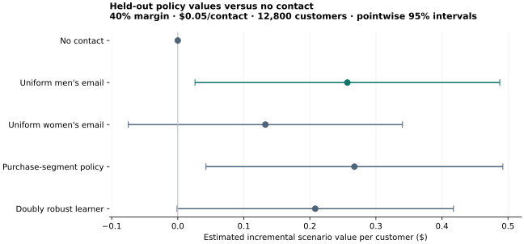

# Causal Customer Decisions — empirical report

Prasanna K · 15 October 2026

The learned candidate did not establish superiority over the simple campaign. The predefined comparison estimates a difference of **−$0.0486 per customer**, with a paired 95% normal interval **[−$0.1927, $0.0955]**. The customer bootstrap interval is **[−$0.2017, $0.0815]**. Under the specified assumptions, retain the development-selected uniform men's email policy; this does not establish that uniform campaigns are universally optimal.

## Decision and data

The decision is whether individualized email targeting warrants replacing a simple campaign. Kevin Hillstrom's historical randomized experiment contains 64,000 customers assigned to no email, men's email or women's email. Outcome: actual spending in the following two weeks. Men/women refer to merchandise and campaign content; no customer gender variable is observed.

The input was checked against the documented HTTPS loader and checksum. Every row is retained. A row-position permutation, independent of treatment and outcomes, assigns 38,400 customers to training, 12,800 to development and 12,800 to final evaluation. Published artifacts contain aggregates, not customer-level data. See [data provenance](../docs/DATA.md) and [the analysis protocol](../docs/PROTOCOL.md).

## Method and selection

Three training-only cross-fitting folds estimate arm-specific mean spending with fixed histogram gradient boosting. Known randomization probabilities produce augmented scores; two regularized regressions learn treatment contrasts against no contact. A separate baseline uses four historical-purchase segments with shrinkage toward training arm means. No hyperparameter search or post-test refitting was performed.

The development-selected simple comparator is **Uniform men's email**. The selected learned candidate is **Doubly robust learner**. Selection uses the development lower confidence bound of incremental scenario value against no contact. These choices are recorded in `selection.json` before evaluation code accesses test outcomes.

For action a, the score is:

`Gamma_a = mu_a(X) + I(A=a) * (Y - mu_a(X)) / p_a`, with `p_a = 1/3`.

The score for policy pi is `margin * Gamma_pi - contact_cost * I(pi != 0)`. Differences between policies are calculated customer by customer, preserving their covariance. Randomization and out-of-sample nuisance fits support an unbiased value estimate even with a misspecified outcome model, subject to the experiment assumptions. The learner does not reveal true individual treatment effects.

## Primary held-out results

Assumptions: 40% contribution margin, $0.05 per contact, no binding contact cap. These are scenario inputs; contribution is not an observed financial outcome.

| Policy | Incremental scenario value/customer ($) | Pointwise 95% interval | Contacted |
|---|---:|---|---:|
| No contact | 0.0000 | [0.0000, 0.0000] | 0.0% |
| Uniform men's email | 0.2568 | [0.0261, 0.4875] | 100.0% |
| Uniform women's email | 0.1327 | [-0.0749, 0.3402] | 100.0% |
| Purchase-segment policy | 0.2674 | [0.0427, 0.4922] | 100.0% |
| Doubly robust learner | 0.2081 | [-0.0011, 0.4174] | 94.9% |

The primary paired comparison of the learned candidate against the simple comparator is -0.0486, 95% CI [-0.1927, 0.0955]. The IPW-only sensitivity estimate is -0.0747, 95% CI [-0.2188, 0.0695]. Neither estimator establishes superiority. A positive point estimate for any other exploratory policy is not grounds to switch the selected candidate after viewing test results.

## Why uncertainty matters here

99.14% of evaluation customers spent nothing. The 99.9th percentile of spend is $215.94; the maximum is $499.00. Sparse purchases and a heavy spending tail make an incremental policy comparison noisy. The raw outcome was not trimmed after seeing the results. The report includes a paired customer bootstrap and IPW sensitivity rather than presenting a fragile point estimate alone.

## Scenario exploration

The offline demonstration evaluates a predefined grid of margins, contact costs and capacity limits. Learned policies contact only customers with positive predicted incremental scenario value and rank them under the cap. Uniform policies use a fixed random priority under a cap. All action choices use covariates and fixed model outputs, not test outcomes.

These secondary comparisons are exploratory. Displayed intervals are pointwise, conditional on the fixed trained models; capped-batch comparisons are conditional on this customer batch's covariates. They are not simultaneous confidence bands and must not be used to select a new winner and call it confirmatory. Bootstrap intervals for the primary contrast do not account for retraining variability across new experiments.

## Checks and limitations

Schema, numerical finiteness, treatment levels, missingness and outcome consistency pass. Training covariate balance is recorded without using it to exclude inconvenient observations. Tests cover known score identities, randomized null/effect simulations, exclusion of assigned treatment and outcomes from predictors, capacity limits and paired variance. Feature preparation and nuisance fitting respect split/fold boundaries.

The experimental publication is the source of the randomization claim; its allocation system was not independently audited. The observations are old and from one business setting. There is no evidence of current Indian campaign profitability, individual causal ground truth, long-term retention effects or actual retailer costs. Repeated sampling of training data could produce a different policy. The raw dataset has no express redistribution license established here and is obtained separately.

## Reproduction and references

Run `PYTHONPATH=src python -m unittest discover -s tests -v`, then `OMP_NUM_THREADS=2 OPENBLAS_NUM_THREADS=2 PYTHONPATH=src python -m customer_policy.experiment` and `PYTHONPATH=src python -m customer_policy.reporting`. The pinned dependencies, data hashes, split hashes and selection artifacts accompany this report.

- [Hillstrom original challenge](https://blog.minethatdata.com/2008/03/minethatdata-e-mail-analytics-and-data.html).
- [scikit-uplift dataset documentation](https://www.uplift-modeling.com/en/latest/api/datasets/fetch_hillstrom.html).
- [GRF policy-learning guide](https://grf-labs.github.io/grf/articles/policy_learning.html), methodological background for policy learning and doubly robust scores. This project implements a different fixed DR-learner and does not claim to reproduce GRF's algorithm.
- [scikit-learn histogram gradient boosting](https://scikit-learn.org/stable/modules/generated/sklearn.ensemble.HistGradientBoostingRegressor.html).
