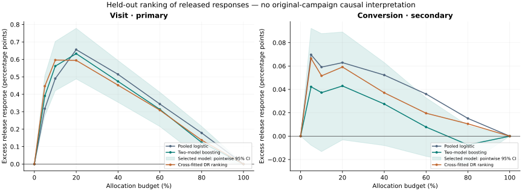
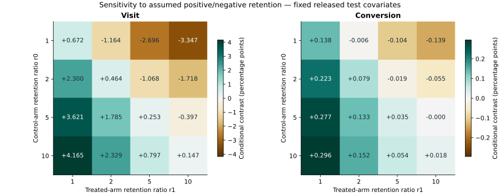
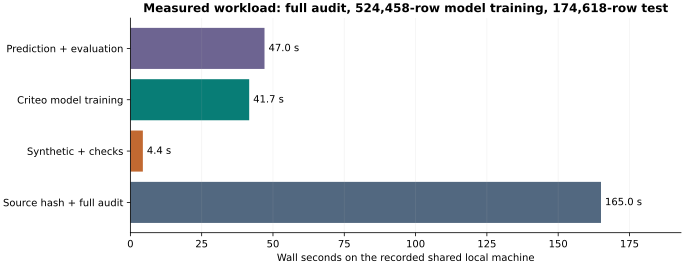

# Criteo: scale, released-response ranking and selection sensitivity

**Result:** stronger factual prediction does not establish a better primary ranking. Development selected two-model boosting, but its held-out visit ranking difference against pooled logistic is **-0.000195**, 95% fingerprint-cluster interval **[-0.001062, 0.000671]**. This is an integrated **released-response** ranking index, not identified advertising uplift. The original Hillstrom randomized decision remains unchanged.

[Interactive evidence explorer](../../docs/criteo/index.html) · [Frozen protocol](../../docs/criteo/PROTOCOL_V1.md) · [Data and identification](../../docs/criteo/DATA_AND_IDENTIFICATION.md) · [Reproduction](../../docs/criteo/REPRODUCE.md) · [Machine-readable results](results.json)

## Design and information boundaries

The complete 13,979,592-row source passed checksum, schema, finite-value and binary-label checks. A prespecified feature-hash rule selected 873,520 rows: 524,458 training, 174,444 development and 174,618 final evaluation. The latter contains 154,294 fingerprint groups. Across the complete release, 1,626,259 rows repeat an existing feature fingerprint. Identical feature vectors stay in one partition and one nuisance fold; the fingerprint is not a verified person or advertiser ID. No cohort collision between different exact vectors was observed.

Only f0–f11 enter the models. Exposure, treatment and both labels are excluded from ranking features; treatment enters pooled response prediction only as its conditioning variable. No visit label predicts conversion or vice versa. Three fixed candidate rankings compete: a pooled logistic response model, two boosted response models, and a three-fold DR pseudo-outcome regressor. Numeric projected features are treated as ordered; this baseline encoding does not recover their semantics. No tuning, early stopping or final-test refit occurs.

The model and development choice were serialized and hashed in [selection_lock.json](selection_lock.json) before computing test metrics. The protocol was locally frozen at 09:56:41 UTC on 26 October 2026, with SHA256 14c70e46426caa94fdf2f3cdc56dd41e13f51f25b00dff17672ed2663bfbf737. It is not an external preregistration.

## Factual response prediction

These metrics compare predicted probabilities with observed held-out labels in the released sample. They measure factual prediction, not effect accuracy. The DR learner outputs a ranking score and has no separate factual probability model.

| Outcome | Response model | Log loss ↓ | Brier ↓ | ROC AUC ↑ | Average precision ↑ |
|---|---|---:|---:|---:|---:|
| visit | Arm constants | 0.185440 | 0.043586 | 0.517535 | 0.047278 |
| visit | Pooled logistic | 0.110409 | 0.031045 | 0.930183 | 0.467324 |
| visit | Two-model boosting | 0.102523 | 0.029447 | 0.944539 | 0.500961 |
| conversion | Arm constants | 0.019605 | 0.002855 | 0.523774 | 0.003007 |
| conversion | Pooled logistic | 0.012397 | 0.002558 | 0.949731 | 0.198639 |
| conversion | Two-model boosting | 0.011722 | 0.002467 | 0.955602 | 0.228853 |

Visit has 7,978 held-out positives (925 control, 7,053 treated). Conversion has only 500 (51 control, 449 treated). Armwise metrics and counts are in [factual_metrics.csv](factual_metrics.csv). Lower factual loss for boosting does not imply that its difference of two response surfaces ranks incremental response more reliably.

## Locked released-response ranking

The common augmentation score uses training-only response models and a fitted released-sample treatment classifier. For allocation a at budget b, the ranking curve is mean((a−b)×psi). Its trapezoid integral over the frozen budget grid is the reported index. At b=0 and b=1 the excess over equal-budget random allocation is exactly zero. A duplicate-feature group crossing a budget receives one fractional probability, keeping its members together in expectation.

| Outcome | Ranking | Integrated excess release response | Pointwise 95% interval |
|---|---|---:|---|
| visit | Pooled logistic | 0.003585 | [0.002689, 0.004480] |
| visit | Two-model boosting **(locked)** | 0.003390 | [0.002502, 0.004278] |
| visit | Cross-fitted DR ranking | 0.003360 | [0.002509, 0.004211] |
| conversion | Pooled logistic | 0.000381 | [0.000107, 0.000654] |
| conversion | Two-model boosting **(locked)** | 0.000169 | [-0.000104, 0.000443] |
| conversion | Cross-fitted DR ranking | 0.000295 | [0.000026, 0.000565] |

The confirmatory extension contrast is the locked **visit** candidate minus pooled logistic. Its Gaussian cluster-multiplier interval, using 1,000 draws, is [-0.001072, 0.000696], consistent with the sandwich interval. Superiority is not established. Conversion is secondary: the corresponding paired difference is -0.000211 [-0.000341, -0.000082]. That secondary result favors pooled logistic on this release metric, but it does not authorize switching the primary decision or claiming campaign harm.

Intervals are paired within the same evaluation observations and clustered by feature fingerprint. They condition on fixed trained models, development choice and batch rank cutoffs. They omit retraining uncertainty, unidentified person/advertiser dependence and selection-mechanism uncertainty. They are pointwise, not simultaneous bands. The few control conversions limit secondary evidence. IPW-style curves are reported beside augmentation in [results.json](results.json) as a nuisance-model diagnostic.

The learned released-treatment probability ranges from 0.803721 to 0.924724; no evaluation row is clipped by the prespecified [.05,.95] bounds. Treatment ROC AUC is 0.510354. Log loss is 0.421509 versus 0.421689 for the training-proportion constant. These are diagnostics, not evidence that outcome-dependent selection has been undone. The roughly 85% treatment fraction is an empirical proportion, not a known released-sample randomization propensity.

## Selection assumptions change the reconstructed decision

The publisher describes label-dependent negative sampling and advertiser rebalancing in [Diemert et al. (2021), section 3](https://arxiv.org/html/2111.10106). The original retention probabilities are unavailable. The following is therefore a sensitivity exercise.

For each arm, suppose the positive-to-negative retention ratio r is constant over X. If s is the released conditional response, Bayes odds give p=s/[r(1−s)+s]. We apply this inversion to training-fitted response models evaluated on the same released test covariates. Causal interpretation additionally requires original conditional exchangeability, consistency, overlap and correct models. The original covariate distribution remains unidentified.

| Visit assumption | Mean reconstructed contrast | Positive contrast share | Zero-cost allocation at 20% cap |
|---|---:|---:|---:|
| r0=1, r1=1 | 0.6718 percentage points | 81.6766% | 20.0000% |
| r0=1, r1=2 | -1.1640 percentage points | 9.5746% | 9.5746% |
| r0=2, r1=1 | 2.3002 percentage points | 99.9416% | 20.0000% |
| r0=10, r1=10 | 0.1467 percentage points | 81.6766% | 20.0000% |

Changing only the assumed treated-arm retention ratio from 1 to 2 reverses the mean visit contrast. This does not reveal the true ratio; it demonstrates why the release alone does not identify the original decision. All 128 outcome/ratio/cost combinations are retained in [selection_scenarios.csv](selection_scenarios.csv). Costs are response-probability units, not money. Scenario allocations use positive net reconstructed responses, capped at 20%; these model-based calculations have no causal or sampling confidence intervals. The separate visit and conversion grids do not specify a coherent joint two-label selection mechanism.

## Known-truth evidence

An exact three-stratum oracle has true mean contrast .005. Applying declared retention ratios produces a naive selected contrast .124206 at the same stratum weights; inversion recovers .005 to 1.39e-17 maximum stratum error. A constant-X counterexample shows that covariate balance can coexist with severe selected-response distortion.

An independent synthetic experiment trains on 60,000 and evaluates on 40,000 simulated observations with known randomized assignment and nonlinear response truth. PEHE is 0.023670 for pooled logistic, 0.014830 for two-model boosting and 0.009984 for DR. These values validate a runnable effect-learning implementation under known truth; they do not establish Criteo effects. One of the three synthetic pointwise intervals misses its known policy contrast by a small amount. That miss is retained. A single simulation is not a coverage study. See [synthetic_checks.json](synthetic_checks.json).

## Measured workload and verification

The first source verification/audit/cohort pass took 165.0 seconds and reached 731.8 MiB observed process RSS. The complete model/synthetic/test/evaluation pipeline took 95.6 seconds, with 441.4 MiB observed process RSS. Sampling every 50 ms can miss brief peaks. These shared-machine timings use two model threads on eight logical CPUs. A 14M-row audit is not a full-14M model fit.

All 44 public tests pass. Independent allocation, integration, uncertainty, factual-loss and odds-inversion recomputation passes 190 checks, with maximum difference 5.55e-17. A second complete fixed-model synthetic/real run reproduces 2622 scientific numeric fields with maximum difference zero; serialized model hashes also match. The verified analytical cohort is reused for that rerun. Source ingestion was run once. [Verification receipt](verification.json).

## What this project supports

The extension provides an auditable large-file pipeline, leakage-resistant split design, finite model budget, factual benchmarks, a failed primary ranking-superiority comparison, measured local resource use and explicit selection sensitivity. It does not establish original campaign uplift, current business ROI, deployment safety or a new statistical algorithm. Hillstrom remains the separately interpretable randomized case.

Method reference: [Kennedy, Towards optimal doubly robust estimation of heterogeneous causal effects](https://arxiv.org/abs/2004.14497). The release uses established learners; its contribution is the implementation, identification boundary and reproducible evidence chain.

Prasanna K · Economics student, Madras School of Economics, 2026–28.
